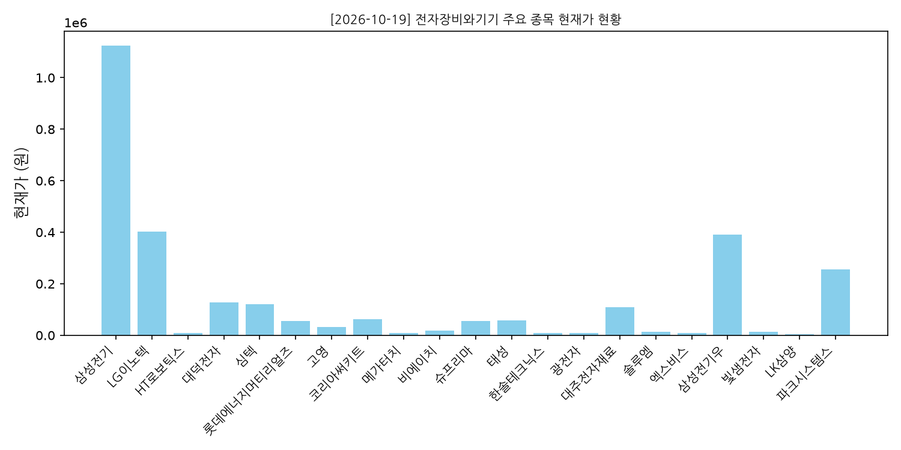
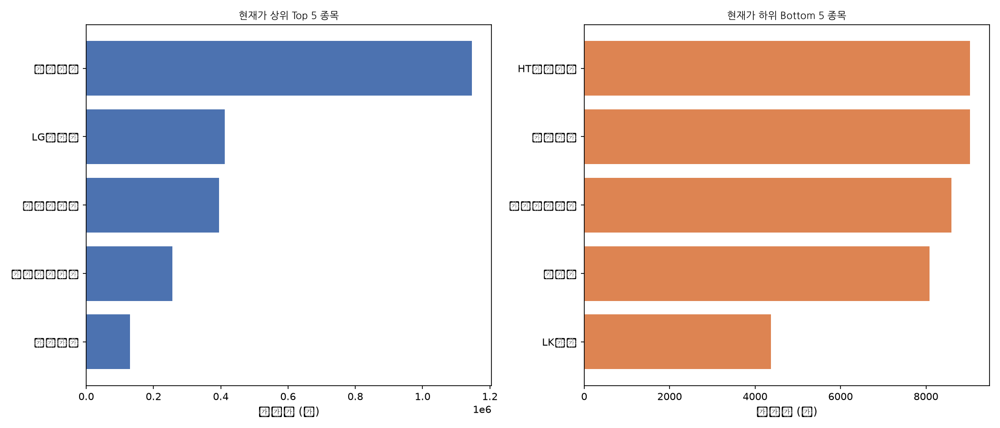
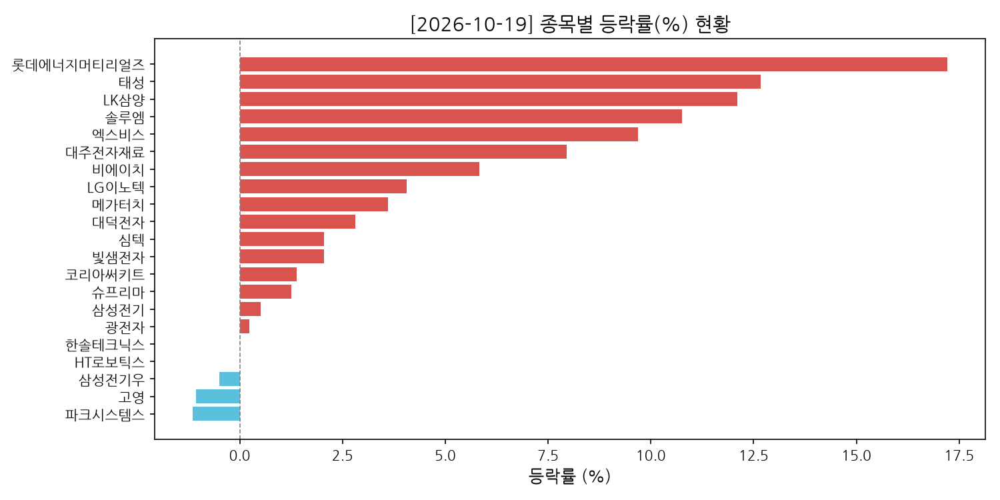
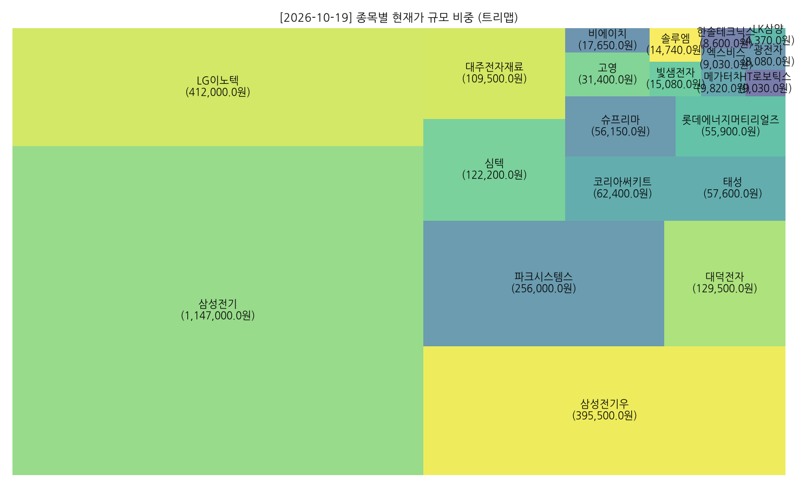

# 📈 stock_collecter_Areum
> **전자장비와기기 업종 자동화 주식 데이터 수집 및 대시보드 리포트 시스템**

## 📊 실시간 수집 시각화 대시보드 (Daily Dashboard)

| 1. 전체 종목 현재가 현황 | 2. 상하위 집중 비교 (Top/Bottom) |
| :---: | :---: |
|  |  |

| 3. 종목별 등락률(%) 현황 | 4. 종목별 규모 비중 (트리맵) |
| :---: | :---: |
|  |  |

[📊 전체 마크다운 보고서 열기](./reports/) | [🚀 자동화 파이프라인 작동 현황](#-프로젝트-주요-특징-features)

---

## 🎯 프로젝트 소개 (Overview)
GitHub Actions와 Python을 활용하여 매일 정해진 시간에 '전자장비와기기' 업종의 주식 확장 지표를 자동으로 수집하고, 대시보드형 마크다운 리포트와 분석 차트(`chart`, `top_bottom_chart`, `change_chart`, `treemap`)를 생성하여 관리하는 파이프라인 프로젝트입니다.

---

## 🚀 프로젝트 주요 특징 (Features)

- **자동화된 일일 수집**: GitHub Actions를 통해 매일 자동으로 최신 주식 데이터를 수집하고 검증합니다.
- **4종 대시보드 시각화 리포트**: 
  - 📈 **전체 종목 현재가 현황 바 차트**
  - ⚖️ **상하위 집중 비교 차트 (Top / Bottom N)**
  - 📊 **종목별 등락률(%) 현황 바 차트 (상승/하락 색상 구분)**
  - 🗺️ **종목별 규모 비중 트리맵 (Treemap)**
- **리포트 자동 생성**: 수집된 데이터와 시각화 차트를 결합하여 `reports/` 내에 대시보드 보고서로 자동 기록합니다.

---

## 🗂️ 프로젝트 구조 (Project Structure)

```text
stock_collecter_Areum/
├── .github/
│   └── workflows/         # GitHub Actions 자동화 워크플로우 (collect, report)
├── data/
│   └── 전자장비와기기/    # 날짜별 수집된 원본 CSV 데이터 저장소 (YYYY-MM-DD.csv)
├── reports/               # 자동 생성된 대시보드 마크다운 보고서 및 시각화 이미지(.png)
├── generate_report.py     # 대시보드 리포트 및 시각화 차트 생성 스크립트
├── stock_validator.py     # 네이버 API 데이터 수집 및 검증 + 이메일 전송 스크립트
├── NanumGothic.otf        # 한글 폰트 파일
└── requirements.txt       # 파이썬 패키지 의존성 목록
