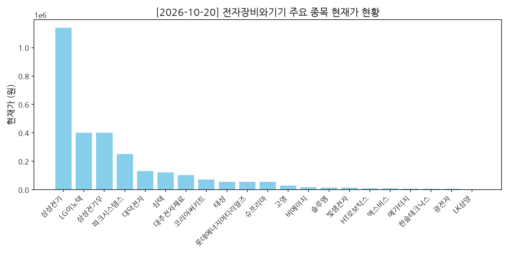
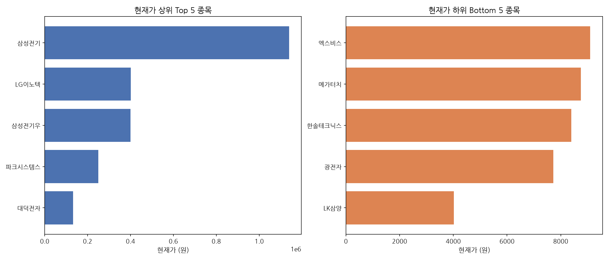
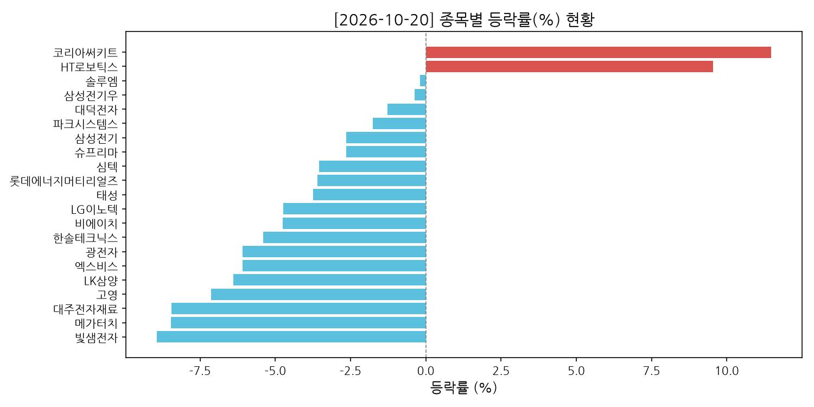
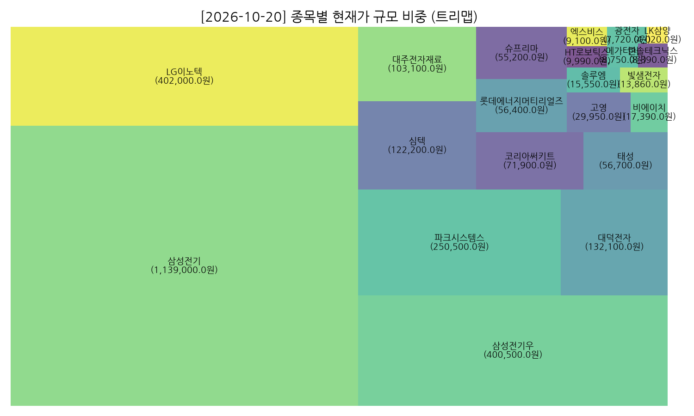

# [2026-10-20] 전자장비와기기 업종 일일 대시보드 보고서

> 수집된 총 종목 수: **21개** | 데이터 기준일: **2026-10-20**

---

## 📊 대시보드 시각화 요약

### 1. 전체 종목 현재가 현황

### 2. 상하위 집중 비교 분석 (Top / Bottom)

### 3. 종목별 등락률(%) 현황

### 4. 종목별 규모 비중 (트리맵)

---

## 📋 상세 종목 데이터 테이블

| 종목명        | 종목코드   |        현재가(종가) |   등락률(%) |        거래량 |
|:-----------|:-------|---------------:|---------:|-----------:|
| 삼성전기       | 009150 |      1.139e+06 |    -2.65 |  1,154,512 |
| LG이노텍      | 011070 | 402000         |    -4.74 |    180,532 |
| HT로보틱스     | 396300 |   9990         |     9.54 | 27,297,959 |
| 대덕전자       | 353200 | 132100         |    -1.27 |  1,460,698 |
| 심텍         | 222800 | 122200         |    -3.55 |  1,757,016 |
| 롯데에너지머티리얼즈 | 020150 |  56400         |    -3.59 |    840,110 |
| 고영         | 098460 |  29950         |    -7.13 |  1,406,614 |
| 코리아써키트     | 007810 |  71900         |    11.47 |  4,263,929 |
| 메가터치       | 446540 |   8750         |    -8.47 |    314,260 |
| 비에이치       | 090460 |  17390         |    -4.76 |    519,517 |
| 슈프리마       | 236200 |  55200         |    -2.65 |     18,492 |
| 태성         | 323280 |  56700         |    -3.74 |    708,440 |
| 한솔테크닉스     | 004710 |   8390         |    -5.41 |    679,571 |
| 광전자        | 017900 |   7720         |    -6.08 |    471,398 |
| 대주전자재료     | 078600 | 103100         |    -8.44 |    424,454 |
| 솔루엠        | 248070 |  15550         |    -0.19 |    567,009 |
| 엑스비스       | 0011A0 |   9100         |    -6.09 |     70,186 |
| 삼성전기우      | 009155 | 400500         |    -0.37 |     19,581 |
| 빛샘전자       | 072950 |  13860         |    -8.94 |    643,914 |
| LK삼양       | 225190 |   4020         |    -6.4  |    209,979 |
| 파크시스템스     | 140860 | 250500         |    -1.76 |     20,218 |